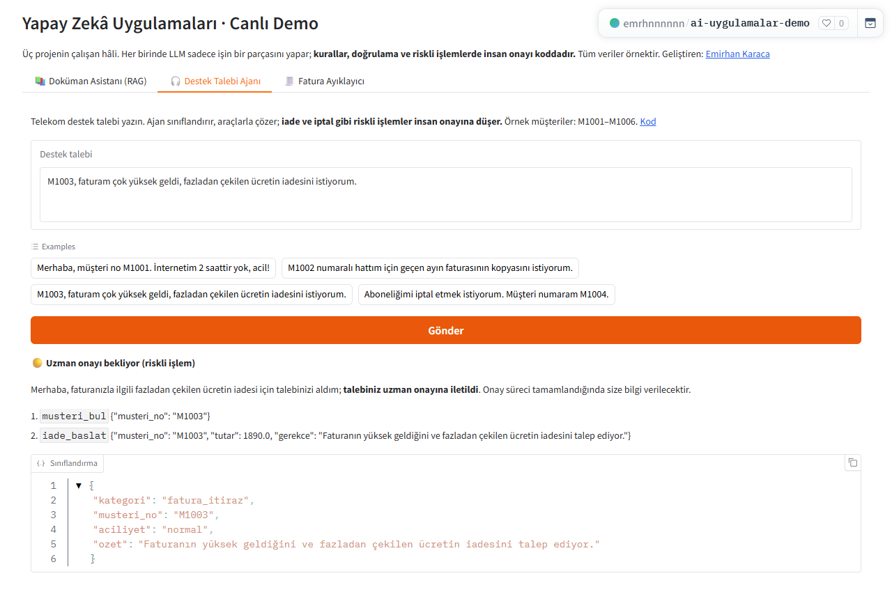

# Support Ticket Agent

*Türkçe: [README.md](README.md)*

**Live demo:** [huggingface.co/spaces/emrhnnnnnn/ai-uygulamalar-demo](https://huggingface.co/spaces/emrhnnnnnn/ai-uygulamalar-demo), tab: 🎧 Destek Talebi Ajanı. The demo runs on OpenAI gpt-5.4-mini; the business logic is the same as in this repo.

Most requests that reach a support team are the same few things: "send me a copy of my invoice", "I forgot my password", "my internet is down". Having a person open each one and do the same steps is tiring and slow. This agent reads the request, understands what it is, and solves the repetitive ones by itself using tools. For anything involving **money or cancellation**, it stops and waits for a human to approve. So the team only steps in where it is really needed. The model runs on my own computer (local LLM), so customer data never leaves it.



## How it works
```
Request (e-mail / form / WhatsApp) → model classifies it → a playbook runs the right tools in order
   → solved automatically | waiting for approval (refund, cancellation) | handed to a human (unknown)
   → model writes the reply · every tool call goes into the audit log
```
| Request type | Tools that run, in order | Result |
|---|---|---|
| Outage | find customer → check for an outage in the area → (if none) open a technical ticket | Automatic |
| Invoice copy | find customer → send invoice | Automatic |
| Password | find customer → send reset link | Automatic |
| Billing dispute / refund | find customer → start refund | **Human approval** |
| Cancellation | find customer → open cancellation request | **Human approval** |
| Other | — | Hand to a human |

The panel shows live counters: how many requests were solved automatically, how many are waiting for approval, how many went to a human, and the automation rate. You can approve or reject with one click, and you can see which tools ran for each request.

## Results (16 labeled requests)
| Version | Correct classification | Correct routing |
|---|---|---|
| v1: the model picks the tools itself | 16/16 | 14/16 |
| **v2: the model only classifies, a playbook picks the tools** | **16/16** | **16/16** |

But this table is only half the story. The real lesson is below.

## What broke, and how I fixed it

**1. The first version looked good.** I gave the model the tools and said "solve the request"; it decided which tool to call and in what order. The routing score was 14/16. Not bad at first sight.

**2. Looking at the tool chain changed the picture.** I made the report also list which tools ran for each request ([v1 report](eval/RAPOR_v1_serbest_arac.md)). The nice score was hiding the real problem:
- **Wrong tool:** for "My bill is doubled, refund me", it opened a **technical fault ticket** instead of a refund. For "Close my line", it again opened a technical ticket instead of a cancellation. The result still landed in the right box (waiting for approval), so the score didn't see it.
- **No tool at all:** for two password requests the model called no tool, and the request went to a human for nothing.
- **Identity check skipped:** the instructions said "find the customer first", but in 5 requests it acted without verifying the customer, and in 1 it verified only afterwards.
- **Missing step:** in two outage requests, it didn't open a technical ticket even though there was no outage.

Only **3/16** requests matched the expected tool chain exactly.

**3. I took the decision away from the model.** The model now only classifies the request, which it already did 16/16. A fixed **playbook** decides which tools run in which order, based on the request type. Anything involving money or cancellation always goes to a human. The model choosing tools freely is now only a fallback for unknown cases.

| | v1: model picks the tool | v2: playbook |
|---|---|---|
| Correct routing | 14/16 | **16/16** |
| Expected tool chain | 3/16 | **16/16** |
| Action with the wrong tool | 3 | **0** |
| Action without verifying the customer | 5 | **0** |

**Lesson:** a metric that only looks at the final box hides errors that reach the right box by the wrong path. With agents you also have to measure the tool chain. And it is safer to use the model where you can't write a rule (understanding the request, writing the reply), not for decisions you can write a rule for.

## Repeatability: is it equally right every time? (Nov 8)
Getting 16/16 in one run could be luck. With a setting that makes the agent behave more randomly (temperature 0.7), I ran each request **5 times** and counted it as a success only if it was right **in all 5 runs** (the pass^k measure).

| Measure | Result |
|---|---|
| Average success in a single run (pass@1) | 80/80 |
| Right in all 5 runs (pass^5) | **16/16** (95% confidence interval: 0.81-1.00) |

I think the reason is the design: the model only classifies the request and the fixed playbook does the rest, so randomness has no room to change the outcome. Limit: 16 requests is few and the confidence interval is wide; it should be measured again with harder, more ambiguous requests. The run was long, so it ran under [Nöbetçi](https://github.com/emirhnnnk-lab/nobetci). Script: `DESTEK_TEMP=0.7 python eval/pass_k.py 5`.

## The path the eval missed (Nov 13)
The 16/16 above holds for the local model (Ollama) and these 16 scenarios; it does not prove every path of the live demo. In a check before sending job applications, I typed a question with no customer number into the live demo ("Çalışma saatleriniz nedir?", "What are your opening hours?"). Both tries returned "Model şu an yanıt vermedi" ("the model did not respond").
Requests with no customer number skip the playbook and fall into the free tool-calling loop. The demo's shared helper added `reasoning_effort="low"` to every call, and the provider rejected that parameter in the same request as tools with HTTP 400. None of the 16 scenarios goes down this path, so the eval could not see the error.
After the fix the model invented opening hours (not in the data), so general questions with no customer number now get a fixed "forwarded to a support agent" reply. In the demo repo, 5 tests with a fake model client guard this path. Details: [Deney Defteri entry](https://github.com/emirhnnnk-lab/deney-defteri/blob/main/backend/seed/experiments.json) (`eval-misses-live-path`).

## Permanent log and SQL reports
Requests, every tool call and every approval decision are written to a database (SQLite): `app/db.py`, tables `talepler` (requests), `arac_cagrilari` (tool calls), `onaylar` (approvals). The audit trail survives a server restart. Reports come from plain SQL: `GET /rapor/<name>`.

| Report | Question it answers |
|---|---|
| `kategori_bazinda_otomasyon` | For each request type, what share is solved with no human? |
| `en_cok_kullanilan_araclar` | Which tools does the agent call most, and in how many requests? |
| `onay_sonuclari` | How many approval items were approved or rejected, by type? |
| `dogrulamasiz_islem` | **Safety audit:** was any action taken without verifying the customer? |

I wrote the last one so that the v1 bug above (acting without verifying the customer) can never slip by silently again. I can audit every call the agent made with a single query. Tests: `tests/test_db.py`.

## Running it
```bash
pip install -r requirements.txt
ollama pull qwen2.5:3b
uvicorn app.main:app --reload     # http://localhost:8000
python eval/degerlendir.py
pytest
```
API: `POST /webhook/talep {"metin": "..."}` · `POST /onay/{id}?karar=onayla|reddet` · `GET /talepler` · `GET /denetim` · `GET /rapor/<name>`

## Tech
Python · FastAPI · Ollama (qwen2.5:3b, tool calling + JSON output) · SQLite · httpx · pytest

> Customer and service data are made up ("Örnek Telekom").

---
Built by **Emirhan Karaca**
